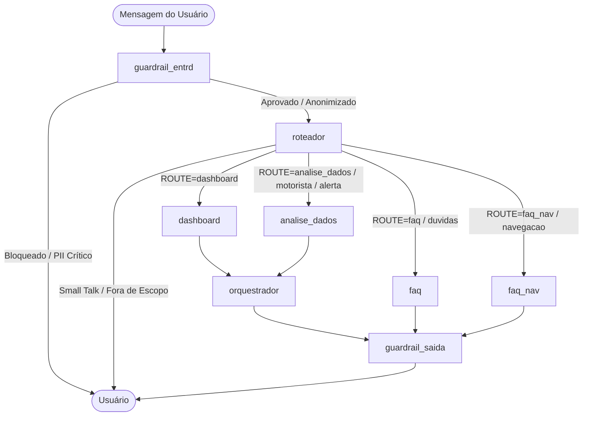

# Arquitetura e Fluxo de Agentes

Documento gerado para representar a topologia e execução do grafo multi-agente construído com **LangGraph** no ecossistema Efficientia.

---

## 1. Topologia Visual do Grafo

---

## 2. Descrição dos Nós e Responsabilidades

| Nó | Função / Papel | Modelo / Ferramentas | Próximo Passo |
|---|---|---|---|
| **`guardrail_entrd`** | Validação de segurança, detecção de prompt injection e anonimização de PII na entrada. | `llm_rapido` (Gemini Flash / Fallback Groq) | `roteador` ou `END` (se bloqueado) |
| **`roteador`** | Análise semântica da intenção do usuário e emissão de protocolo de despacho (`ROUTE=...`). | `llm_rapido` / Sem ferramentas externas | `dashboard`, `analise_dados`, `faq`, `faq_nav` ou `END` (se resposta direta) |
| **`dashboard`** | Interpretação executiva de dashboards corporativos e métricas associativas do Qlik Cloud. | `llm_especialista` / `TOOLS_QLIK` (Qlik MCP Server) | `orquestrador` |
| **`analise_dados`** | Inspeção dinâmica de esquemas e execução de queries analíticas no banco PostgreSQL corporativo. | `llm_especialista` / `TOOLS` + `TOOLS_MEMORIA` | `orquestrador` |
| **`faq`** | Resolução de dúvidas institucionais, políticas e regulatórias com base no FAQ oficial. | `llm_rapido` / `faq_retriever` (FAISS sobre `FAQ.md`) | `guardrail_saida` |
| **`faq_nav`** | Resolução de dúvidas de uso da interface, menus, telas, abas e navegação do sistema. | `llm_rapido` / `faq_retriever` | `guardrail_saida` |
| **`orquestrador`** | Consolidação e refinamento analítico da saída dos especialistas de dados/dashboard. | `llm_rapido` (Invocação direta com persona corporativa) | `guardrail_saida` |
| **`guardrail_saida`** | Revisão de integridade, desanonimização de dados protegidos e validação de compliance final. | `guardrail_saida` | `END` |

---

## 3. Estados e Ciclo de Vida

- **Estado (`Estado`):** Herda de `MessagesState`, persistindo `agentes_chamados`, `rota`, `mapa_pii`, `input`, `saida_especialista` e `resposta_final`.
- **Checkpointer:** `MemorySaver` centralizado garantindo a manutenção da sessão e contexto multi-turn entre interações do usuário.
- **Observabilidade:** Instrumentado via SRE/FinOps para rastreamento de custos de tokens, latência e status por rota executada.
